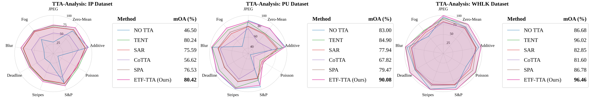

# Anchor: ETF-Guided Invariant Learning for Test-Time Adaptation in Hyperspectral Image Classification

Official implementation of **"Anchored Under Shift: ETF-Guided Invariant Learning for Test-Time Adaptation in Hyperspectral Image Classification"**.

---

## Overview

**Anchor** is an ETF-guided framework for HSI test-time adaptation. It has three stages:

1. **Invariant and specific representation learning.** A shared spectral–spatial encoder is trained on clean patches and simulated spectral/spatial/shot-noise degradations. The latent representation is split into a degradation-invariant part and a degradation-specific part, using cross-degradation contrastive alignment (CD) and a normalized kernel-alignment disentanglement loss (RD).
2. **Fixed ETF class anchors.** A fixed simplex equiangular tight frame (ETF) defines the class geometry. Classification uses cosine similarity to the ETF vertices, which stay frozen during both training and test-time adaptation.
3. **Confidence- and stability-weighted ETF-TTA.** At test time, only confident samples (`p_max >= 0.90`) drive adaptation. Their weights depend on agreement with a frozen reference model. Only BN/LN affine parameters are updated.

<p align="center">
  
</p>

<p align="center"><em>
Figure 1. (a) Conventional TTA adapts pretrained models using prediction-driven objectives such as entropy minimization and confidence filtering.
(b) Anchor: (1) invariant–specific representation learning with cross-degradation alignment and disentanglement;
(2) fixed ETF class anchors; (3) confidence- and reference-stability-weighted test-time adaptation restricted to BN/LN affine parameters.
</em></p>

---

## Results

Average results over nine degradations (JPEG, Zero-Mean Gaussian, Additive Gaussian, Poisson, Salt&Pepper, Stripe, Deadline, Blur, Fog), averaged over five seeds:

| Dataset | OA (%) | AA (%) | Kappa (%) |
|---|---|---|---|
| Pavia University (PU) | 90.08 | 92.63 | 87.49 |
| WHU-Hi-LongKou (WHLK) | 96.46 | 97.49 | 95.63 |
| Indian Pines (IP) | 80.42 | 88.13 | 78.00 |

### TTA comparison with the same Proto-ETF model

Radar charts comparing TTA strategies on the same trained Proto-ETF model across the nine degradations (IP, PU, WHLK):

<p align="center">
  
</p>

<p align="center"><em>
Figure 6. Radar charts of different TTA methods on IP (left), PU (middle), and WHLK (right) across nine degradations using the same Proto-ETF model.
</em></p>

---

## Repository Structure

```
Anchor/
├── assets/                  # README figures (fig1.svg, fig6.png)
├── data_provider/           # data utilities (HyperTTA degradation generators `data_gen`, `info`, ...)
├── etf_tta.py               # ETF-TTA (confidence + reference-stability weighted)
├── metrics.py               # OA / AA / Kappa
├── proto_etf_modules.py     # ProtoEncoder, generate_etf_simplex
├── pu_dataset.py            # dataset loaders, normalization, splits, OnTheFlyDataset
├── training_pipeline.py     # Decoder, perturbations, CE / CD / RD losses, training_step
├── train_proto_etf.py       # training script
├── test_etf_tta.py          # evaluation script (no-adaptation baseline + ETF-TTA)
└── requirements.txt         # pip dependencies
```

Trained checkpoints (`proto_etf_<dataset>_seed{seed}.pth`) are written to the repository root by `train_proto_etf.py` and read from there by `test_etf_tta.py`.

---

## Installation

```bash
git clone https://github.com/mir8077faiyaz/Anchor.git
cd Anchor

# create an environment (example)
conda create -n anchor python=3.10 -y
conda activate anchor

# install PyTorch for your CUDA version from https://pytorch.org, then:
pip install -r requirements.txt
```

---

## Data Preparation

Experiments use three public HSI benchmarks:

| Dataset | Size | Bands | Classes | 
|---|---|---|---|
| Pavia University (PU) | 610 × 340 | 103 | 9 | 
| WHU-Hi-LongKou (WHLK) | 550 × 400 | 270 | 9 | 
| Indian Pines (IP) | 145 × 145 | 200 | 16 | 

1. Download the datasets (image cube and ground-truth map)
2. Put them in a single data directory laid out as expected by the loaders in `pu_dataset.py` (`load_pines`, `load_pu`, `load_whlk`).
3. Set `DATA_ROOT` at the top of both `train_proto_etf.py` and `test_etf_tta.py`:

```python
DATA_ROOT = r"/path/to/your/data"
```

---

## Training

Train one model per seed (`42, 43, 44, 45, 46`) for the chosen dataset:

```bash
# Indian Pines
python train_proto_etf.py --dataset Pines

# Pavia University
python train_proto_etf.py --dataset Pavia

# WHU-Hi-LongKou
python train_proto_etf.py --dataset WHLK
```

Each run saves one checkpoint per seed in the working directory:

| `--dataset` | Checkpoint |
|---|---|
| `Pines` | `proto_etf_pines_seed{seed}.pth` |
| `Pavia` | `proto_etf_pu_seed{seed}.pth` |
| `WHLK` | `proto_etf_whlk_seed{seed}.pth` |

Each checkpoint contains the encoder, the decoder, the fixed ETF vertices, and the model configuration.

---

## Testing / Test-Time Adaptation

Evaluate the trained checkpoints under the nine HyperTTA degradations. Use the same `--dataset` you trained with:

```bash
# Indian Pines
python test_etf_tta.py --dataset Pines

# Pavia University
python test_etf_tta.py --dataset Pavia

# WHU-Hi-LongKou
python test_etf_tta.py --dataset WHLK
```

For every seed and every degradation, the script:

1. Loads `proto_etf_<dataset>_seed{seed}.pth`.
2. Applies the real HyperTTA corruption to the raw cube, then per-band normalizes the corrupted cube.
3. Runs the **no-adaptation** baseline (cosine similarity to the fixed ETF).
4. Runs **ETF-TTA**. It starts from a fresh model copy and deep-copies a frozen reference model. Only samples with `p_max >= 0.90` contribute, and reference-disagreeing samples get weight 0.5. Only BN/LN affine parameters are updated, with Adam at LR 1e-3.
5. Records OA, AA, and Kappa per seed and per corruption.

At the end it prints the mean ± std over the five seeds per corruption, plus the corruption-averaged mOA / mAA / mKappa, for both the no-TTA baseline and ETF-TTA.


## Acknowledgements

The degradation benchmark builds on [HyperTTA](https://doi.org/10.1016/j.neucom.2026.133188). We thank the authors for providing the [Multi-degradation Simulator code](https://github.com/halfcoder1/HyperTTA/tree/master).

## Contact

For questions, please open an issue in this repository.
